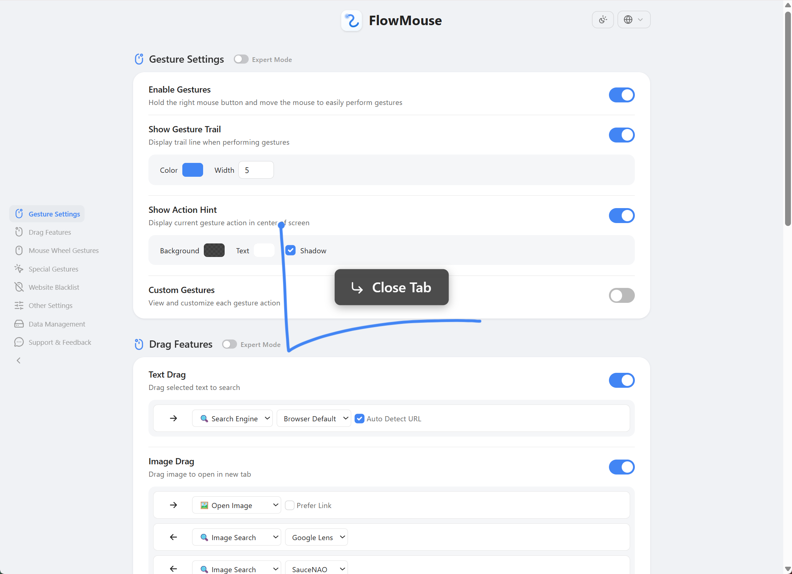

# FlowMouse

**마우스 움직임으로 탐색하고, 드래그로 바로 실행하세요.**

Chrome·Edge용 마우스 제스처 확장 · ozone-aged 독립 개선판.

[설치 ZIP](https://github.com/ozone-aged/FlowMouse/releases/latest) · [설치 방법](docs/INSTALL.ko.md) · [주요 기능](#주요-기능) · [문서](#문서)

v2.5-ozone.1 · 확장 버전 2.5.0.1 · GPL-3.0

## 주요 기능

| 조작 | 기능 |
| :--- | :--- |
| 마우스 제스처 | 기본·사용자 지정 제스처로 탐색·탭 제어 |
| 슈퍼 드래그 | 텍스트 검색, 이미지 열기·저장, 링크 열기·복사 |
| 휠·로커 제스처 | 마우스 버튼과 휠 또는 다른 버튼을 조합해 실행 |
| 영역 선택 | Shift+드래그로 여러 링크를 선택해 열기·복사 |
| 명령 체인 | 하나의 제스처에 여러 동작 연결 |
| 설정 | 동작 검색, 궤적·색상·안내 표시, 설정 가져오기 |

## 설치하기

Windows·macOS의 Chrome 또는 Edge에서 사용합니다.

1. [Releases](https://github.com/ozone-aged/FlowMouse/releases/latest)에서 **FlowMouse-Chromium-2.5.0.1.zip**을 받습니다.
2. 압축을 풀고 `chrome://extensions` 또는 `edge://extensions`에서 개발자 모드를 켭니다.
3. **압축해제된 확장 프로그램 로드**로 해당 폴더를 선택합니다.
4. 확장 설정에서 제스처와 검색 엔진을 맞춥니다.

설치 ZIP에는 Node.js나 App Manager가 필요하지 않습니다. GitHub의 자동 **Source code ZIP**은 개발용이며 빌드 후 로드해야 합니다. 이 독립 개선판의 설치 파일과 원본 프로젝트의 스토어 배포는 별개입니다. [설치·업데이트 안내](docs/INSTALL.ko.md)

## 기본 조작

| 제스처 | 동작 | 제스처 | 동작 |
| :--- | :--- | :--- | :--- |
| `←` | 뒤로 | `→` | 앞으로 |
| `↑` | 위로 스크롤 | `↓` | 아래로 스크롤 |
| `→↑` | 새 탭 | `→↓` | 새로고침 |
| `↓→` | 현재 탭 닫기 | `←↑` | 닫은 탭 다시 열기 |

모든 제스처는 설정에서 바꿀 수 있습니다. 설정은 브라우저 저장소에 보관하며 브라우저 동기화 여부는 사용자의 브라우저 설정을 따릅니다.

## 문서

- [설치·업데이트](docs/INSTALL.ko.md)
- [변경 기록](docs/RELEASE-NOTES.ko.md) · [보안 검토](docs/SECURITY-REVIEW.md)
- [개발·원본 업데이트 절차](docs/UPDATE.md) · [원본 기록](UPSTREAM.json)
- [라이선스](LICENSE) · [타사 라이선스](THIRD_PARTY_LICENSES.md)

원본은 [Hmily-LCG/FlowMouse](https://github.com/Hmily-LCG/FlowMouse)의 v2.5이며 작성자는 **Hmily [LCG] & Coxxs**입니다. GitHub fork 기능을 쓰지 않은 독립 소스 복사본으로, 원본은 `upstream-v2.5` 태그에 보존합니다. 원본 기능·출처·GPL-3.0 및 타사 라이선스를 유지합니다.
